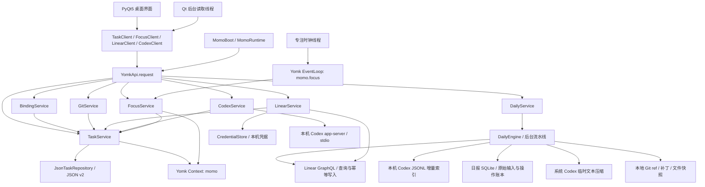

# 星序 0.6.2 · YomkServerPy 架构

## 模块职责

`main.py` 负责控件、筛选展示、交互和系统链接打开。`integration_ui.py` 提供 Linear / Git 原生对话框，`codex_ui.py` 提供历史推荐与新建空聊天对话框，`ui_helpers.py` 提供共用控件构造器。窗口中的 250 ms QTimer 只刷新服务快照；实际计时不依赖 Qt 事件循环。

`clients.py` 是请求适配器，将 Python 调用转换为明确的消息对象与 `/Service/function` 请求。响应以 `ResStatus.eOk` 判定成功，业务错误转成 ValueError，运行或持久化失败转成 OSError，交给界面处理。

`msgs/YomkMsgs.py` 提供 dataclass 消息。类型名只作为内省信息；每个服务端点仍检查消息实例、字段类型、范围与任务是否存在。

`plan_ui.py` 提供原生规划窗口和 QGraphicsView 步骤图，`dag_layout.py` 用拓扑分层及稳定排序自动布局。`task_plan.py` 区分父子包含与同父级前置依赖，并校验缺失节点、重复依赖与循环。`station_ui.py` 现只保留 AttentionDialog，不再提供项目、提交、排队或重试界面。

`model.py` 提供任务数据校验和 `JsonTaskRepository`。只有 TaskService 拥有仓库。写入使用临时文件替换，失败回滚内存修改；损坏文件不会重置为示例数据。

`framework.py` 只选择并导入真实框架：显式 `YOMK_PREFIX_PATH` → 当前解释器已有安装 → 随包的匹配编译库。没有伪造 YomkApi 的兼容层。

## TaskService

| URL | 消息 | 行为 |
| --- | --- | --- |
| `/TaskService/snapshot` | None | 任务、设置、路径、示例标志、revision |
| `/TaskService/list` | None | 任务列表副本 |
| `/TaskService/get` | TaskId | 单任务副本；不存在返回 None |
| `/TaskService/create` | CreateTask | 校验、去重 ID、创建并保存 |
| `/TaskService/delete` | TaskId | 底层删除；外部客户端通过 FocusService/delete_task 调用 |
| `/TaskService/update` | UpdateTask | 只改文字、分类、日期与笔记 |
| `/TaskService/set_status` | TaskStatus | 修改任务状态 |
| `/TaskService/apply_plan` | ApplyTaskPlan | 原子保存本层步骤与显式前置依赖；与打开时基线比较，拒绝覆盖外部编辑 |
| `/TaskService/add_step` | StepInput | 原子追加步骤 |
| `/TaskService/set_step` | StepState | 原子修改步骤状态 |
| `/TaskService/append_binding` | AppendBinding | 校验并原子去重追加关联 |
| `/TaskService/remove_binding` | BindingIndex | 移除关联 |
| `/TaskService/credit_focus` | FocusCredit | 增加并保存专注秒数 |
| `/TaskService/set_focus_minutes` | FocusMinutes | 保存时长偏好 |
| `/TaskService/clear` | None | 清空任务，界面负责删除确认 |
| `/TaskService/append_repository` | RepositoryInput | 工作任务仓库关联去重、保存 |
| `/TaskService/remove_repository` | RepositoryIndex | 移除仓库关联 |
| `/TaskService/import_issues` | ImportIssues | 批量校验、去重、合并，并一次原子写入 |

服务使用 RLock 保护所有仓库访问。创建消息与响应数据均做深复制，避免框架按引用传递消息时被外部修改。该锁覆盖单进程的并发请求。

## FocusService

| URL | 消息 | 行为 |
| --- | --- | --- |
| `/FocusService/snapshot` | None | 当前任务、运行状态、剩余秒数、完成序号与错误 |
| `/FocusService/start` | FocusStart | 开始、继续或切换专注任务 |
| `/FocusService/pause` | None | 暂停并结算累计时间 |
| `/FocusService/reset` | None | 结算后重置本段计时 |
| `/FocusService/tick` | None | 观察单调时钟、完成事件、检查点保存 |
| `/FocusService/set_duration` | FocusMinutes | 结算会话并修改偏好 |
| `/FocusService/clear_selection` | None | 结算并清空当前专注任务 |
| `/FocusService/delete_task` | TaskId | 结算待删任务、删除成功后清理专注引用 |

时钟线程每 250 ms 向 `momo.focus` 投递事件；最多有一个待处理 tick，避免文件保存慢时积压。EventLoop 执行已安装的 tick 处理函数。所有状态命令由 FocusService 的 RLock 保护。

以 monotonic 计算经过时间，不按 tick 次数计时。切换任务时结算旧任务；保留子秒累计以避免频繁暂停丢失时长。每累计 30 秒、暂停、切换、结束或退出时保存完整秒数。异常退出最多丢失尚未到检查点的计时。倒计时结束只产生完成序号，不修改任务完成状态。

写入失败时暂停会话，保留待结算秒数并在快照中报告错误；后续 pause/start 会重试结算，成功后不会重复增加秒数。

## BindingService

`/bind` 接收 BindingInput，支持 `codex://threads/<id>` 与 `https://linear.app/<team>/issue/<identifier>/...`。`/remove` 接收 BindingIndex，`/list` 接收 TaskId，`/resolve` 接收 BindingIndex 并校验即将打开的真实关联。打开应用或浏览器由 Qt 适配层负责。

BindingService 只处理链接，内容读取分别由 LinearService / CodexService 负责。Codex 绑定可以保存已验证的聊天标题。

## CodexService

| URL | 消息 | 行为 |
| --- | --- | --- |
| `/CodexService/recommend` | CodexRecommend | 读取已有聊天与候选历史，按任务内容推荐，可取消 |
| `/CodexService/bind` | CodexBind | 只绑定最近推荐集合中的聊天 ID |
| `/CodexService/create` | CodexCreate | 明确选择后创建空聊天并绑定，不发送消息 |

`codex_support.py` 以参数列表启动 `codex app-server --listen stdio://`，完成 initialize / initialized 握手。仅允许 initialize、thread/list、thread/items/list、thread/read、thread/start、thread/name/set；不会调用 turn/start。JSON 行协议处理交错通知、请求 ID、取消和超时，单帧上限 64 MiB，退出清理子进程。使用当前 CLI 配置，不拷贝登录信息，不解析私有 SQLite 表。

列表按更新时间倒序，每种检索最多 3 页 × 100 条，默认不包含归档与子 agent。先按任务标题、说明、下一步、issue 编号和仓库选出候选，再读取前 35 个元数据候选与最近 25 条聊天的并集，最多 60 条历史。通常每条取最近 3 页 × 100 个条目；旧协议不支持 items/list 时回退 thread/read，在本地保留最近 30 轮。只抽取用户与助手正文，排除工具输出与推理，过滤常见密钥形式。扫描预算为 75 秒，单次协议请求另有超时，因此总耗时不保证严格小于 75 秒。

推荐用中文二元词、英文词和本地规则匹配，同一 issue / 仓库增加权重。返回最多 12 个相关候选；没有明显匹配时返回最多 8 条近期聊天并明确提示。完整正文不进入响应，只返回短片段与匹配原因。内存缓存按聊天 ID + 更新时间失效，不写磁盘，服务退出清除；它是有限候选搜索而非完整全文索引。

Qt 后台线程发起读取，不持有 Task / Focus 锁等待 CLI。关闭时先取消并等待读取线程清理。新建操作不能中途丢弃结果；空聊天创建成功但本地保存失败时保留 ID，重试复用，避免重复创建。UI 在明确确认与目录选择后才新建；任务说明只复制到剪贴板。

## LinearService

| URL | 消息 | 行为 |
| --- | --- | --- |
| `/LinearService/configure` | LinearCredentials | 保存会话密钥；remember=True 时保存本机凭据，清除 issue 缓存 |
| `/LinearService/connection` | None | 返回配置、记忆状态、存储方式和最近 viewer，不返回密钥 |
| `/LinearService/pull` | LinearPull | 读取当前用户、分页拉取 assignedIssues，可取消 |
| `/LinearService/import` | LinearImport | 只允许导入最近成功拉取缓存中的 issue ID |
| `/LinearService/forget` | None | 删除本机保存值与会话值，不修改进程环境变量 |

`linear_support.py` 使用标准库 urllib，固定 HTTPS 终点 `https://api.linear.app/graphql`，个人 Key 放在 Authorization header，禁用重定向。检查 HTTP 与 GraphQL 错误，不展示包含凭证或服务器原文的错误；每个请求超时 15 秒，响应上限 8 MiB，最多 200 页、每页 50 项。分页校验 cursor、viewer 一致性和完整字段；失败或取消不返回部分结果。

拉取由 QThread 发起，服务本身同步执行，持有 LinearService 的独立 RLock；网络等待不持有 TaskService / FocusService 锁。对话框关闭时发出取消事件，等当前请求退出后再销毁线程。主窗口关闭也先处理该线程。

导入在 TaskService 锁内合并任务，按 issue ID 或工作区 / issue 编号去重。第一次创建映射远端初始状态；以后只更新 `linear_issue` 元数据和链接，保留本地工作内容。数据快照统一深复制，密钥不进入 Context、日志消息、dataclass repr 或任务文件。取消事件只用于本进程线程协作，不作为返回对象。

`credentials.py` 按数据目录散列为密钥环选择命名空间。有 DBus 会话且 Python keyring 选中 SecretService / libsecret 后端时优先使用；否则独立存储在 `.credentials/linear.key`，目录 0700 / 文件 0600，使用原子替换，拒绝符号链接与不安全文件权限。回退文件没有额外加密。密钥优先级：显式会话值 → `LINEAR_API_KEY` → 本机保存值；服务退出清除内存引用，只有主动选择记忆的凭据保留。

## GitService

`/bind` 接收 GitInput，`/remove` 和 `/resolve` 接收 RepositoryIndex。`git_support.py` 通过参数列表运行 `git rev-parse` 检查本地仓库，禁用 fsmonitor、忽略继承的 GIT_* 定位变量，设置 5 秒超时；支持子目录、worktree 与 bare 仓库。保存规范化的绝对根目录，打开前重新检查。

远程地址接受 HTTPS / Git SSH，拒绝内嵌 token / 密码、query 与 fragment，保存对应浏览器地址。任务数据中的 `repositories` 是可选字段，旧版 JSON 无需补字段也可读取；仅工作任务可有仓库关联。模块不执行 clone、fetch 或工作区修改。

锁的调用方向保持 Codex / Linear / Git / Binding / Focus → Task；Task 不反向调用其他服务，避免交叉锁死锁。删除由 Focus 协调，不能从 TaskService 锁中反向请求 Focus。

## Context 与生命周期

Context 的 `momo` 分组包含 `data_path`、`task_revision`、`focus_snapshot`。服务每次发布新快照，不直接修改 GET 得到的可变对象。

启动采用框架项目模板的 `before → start → after`：建立 Context；依次注册 TaskService、BindingService、GitService、LinearService、CodexService、FocusService；启动事件循环和时钟。任一步骤失败，MomoRuntime 清理已启动部分。

退出由主控线程执行：先停止日报调度并回收压缩子进程 → 停止并回收工作站子进程、线程与实例资源 → 停止时钟投递 → 暂停并保存专注时间 → 销毁 EventLoop → 逆序注销服务 → 删除 Context keys → 应用入口调用一次 `api.shutdown()`。服务 deinit 不依赖服务表，不调用全局 shutdown。服务中保留存活标志，注销后旧的绑定处理函数会返回 eNo。

框架关闭后不能在同一进程重新初始化。测试可以在同一框架生命周期内创建、关闭多个应用服务会话；框架由进程退出或主入口统一关闭。

## 同进程固定工作站依赖

`station_backend.py` 通过固定导出的真实 `ServiceRuntime` 注册 `/DesktopExecutionService`，复用 `ProjectManager` → `ProjectLifecycleService`、`Database`、schema v12、Task 与 repositories。项目拥有独立实例级 Yomk 运行时；Momo 1.5.6 全局门面与工作站 1.4.20 类、Enum 不混用。同进程不要求同一个服务表；不存在重复注册 `/TaskService` 的覆盖。

`station_ui.py` 提供原生项目、队列、处理、验收与执行预览。`station_executor.py` 负责工作执行模型运输，`daily_summary.py` 负责必要文本压缩；两者都只使用系统 CLI。前者使用本机 `codex exec`、用户明确选的目录权限、当前系统配置/认证与结构化报告；应用不自行调用模型 API。历史仍走同一系统 `codex app-server`。两者均继承系统 CODEX_HOME、配置和认证环境，不执行登录命令，不强制模型/provider，不保留应用登录目录覆盖。

桌面队列保存完整输入、UUID、payload hash、Git 基准、结果与验收。用户设置并发数，同 Git 根和相互包含目录互斥。结果状态与个人四态分离；产物仅接受工作目录内真实文件。服务调用由显式 RLock 串行修改，执行子进程在工作线程运行，不持有个人任务服务锁等待模型。

`MomoRuntime.close()` 先停止日报调度和取消压缩、等待日报线程 → 再关闭工作站执行生产者、停止整个子进程组并 join 工作线程，然后释放工作站拥有的 Yomk 实例和全部 thread-local SQLite 连接，再结算专注和注销 Momo 服务。关窗到托盘不调用此清理流程。异常重启先标记在途记录待核实，不自动重新执行。

数据库、备份、日志和工作区均归 Momo 数据目录；原工作站目录没有修改。原完整 StationController、HTTP、发现、远程派发、Secretary/PM/DAG 与 provider router 未装配。当前补充/重试是明确的新执行，不冒充 checkpoint 恢复。详细选择与后续阶段见 `WORKSTATION_INTEGRATION.md`。

## DailyService 与自动进度

`MomoRuntime` 在 EmbeddedStation 成功后注册 `/DailyService`，拥有调度线程、取消事件、SQLite 和流水线。`/snapshot`、`/configure`、`/retry` 为短请求；`/choices` 从 Qt 后台线程只读获取归属，不持有日报服务锁等待网络。退出先停日报，再停执行队列，最后注销个人服务。

`daily_history.py` 增量扫描现有 CODEX_HOME 的 sessions/archived_sessions，读取 response_item 用户/助手文本和外层时间戳；按完整行偏移续读，对归档副本去重，过滤工具输出与子 agent。只从首次日报周期开始保存索引文本。兼容性依据本机实际 JSONL 与 Codex 0.159.3 协议，不假定推荐接口的三页结果就是完整记录。

`daily_store.py` 保存源文件位置、事实、冻结输入、摘要缓存、操作账本和日期状态。`daily_engine.py` 串联 issue 同步 → Git 留存 → 必要文本压缩 → 评论发布。先保存 UUID v4，再请求 Linear；不持有 TaskService/FocusService 锁等待网络或模型。创建父 issue 后才创建子 issue，重试复用相同 ID，目标冲突交由人核实。

`daily_summary.py` 分块压缩且按内容缓存，使用系统 Codex 的现有 provider/认证；--ephemeral 避免把摘要任务再次收集。压缩调用关闭 shell、执行器、多 agent、插件、已配置 MCP 和网页搜索，不改变系统配置。`config/read` 仅读取有效配置的服务器名，配置值不进入日志。

`daily_git.py` 使用单独维护保留与 Station 队列互斥，创建不切换的 ref，并保存暂存补丁、工作区补丁和未跟踪文件 tar。捕获前后验证 Git 状态、基准和文件摘要；不调用 hook、提交、推送或重置。补跑只保存当前文件状态，manifest 明确实际捕获时间。

TaskService 新增 `/revision`、`/add_children`、`/attach_issue`。子任务拥有独立完整任务记录，steps 为兼容投影；v1 转 v2 前备份。新映射严格一一对应；历史冲突保留，允许逐项解除，自动同步会明确提示。数据目录 `momo.lock` 先于 Boot/迁移取得，跨进程也不能同时改任务。

## 0.6.1 界面收敛

侧栏、托盘和任务详情只保留待处理记录入口，项目空间、本机执行、项目关联、新建执行及重试入口均移除。保留后台服务与旧记录，日报继续使用同仓库维护保留；工作站原有后端接口没有删除。新步骤的 depends_on 只在本地规划使用，不触发调度、不改变远端 issue 状态。

## 0.6.2 任务连接与学习服务

TaskService 的 `/check_merge` 与 `/merge` 使用 MergeTask(task_id,parent_id,mode)，`child` 调整包含层级，`after` 调整到目标同层并增加显式依赖。分类、父子循环、依赖环及跨层依赖在服务锁内校验，完整子树和已有业务数据在一次原子保存中移动。`/dependencies` 支持明确调整根级或同父级前置；根级依赖也由原生 TaskDag 展示。

工作任务换父级时写入 `linear_parent_pending={parent_id,revision,due_at}`，到下一次 Asia/Shanghai 22:00 才允许远端调整。DailyEngine 以报告周期截止时间核对，不让旧日报的失败重试提前发布新关系。LinearWriter 先读取实际 parent，再使用 issueUpdate(parentId)；操作账本按关系版本分开。`/acknowledge_parent` 只确认相同本地版本，失败或本地再次移动保留待同步标记。

MomoRuntime 在工作站和日报服务后注册 `/LearningService`；学习服务不启动分布式执行。它拥有本地课程目录、明确绑定、版本化作答、生成队列和取消事件。短请求都通过 Yomk，模型调用在独立后台线程进行，不能持有服务锁等待模型。课程进程沿用系统 Codex，通过只读 sandbox 及结构化最终输出返回数据；固定 Qt 阅读器只展示经过验证的数据，不执行生成脚本。

生成请求保存已确认输入版本，自动绑定只针对原学习任务且当前任务上下文及绑定版本均未变化。thread.started 记录本次聊天并尝试绑定回该学习任务。课程完成后展示待审阅状态，来源缺口与教学核查单另显示；结构检查不等于教学验收。并发数由建课界面设置。退出先停止学习进程并回收线程，再停止日报、工作站与个人服务；重启将遗留在途记录标记为中断，不自动重新请求模型。

`learning_content.py` 保留知行本地课程的原正文、稳定 lesson/question ID 及未迁移交互提示。`learning_ui.py` 负责绑定、进度、原生阅读、折叠参考思路、选择题核对及书面自查。记录位于 learning/，不混入 Linear 或工作站项目列表。详细契约和边界见 LEARNING_COURSES.md。
