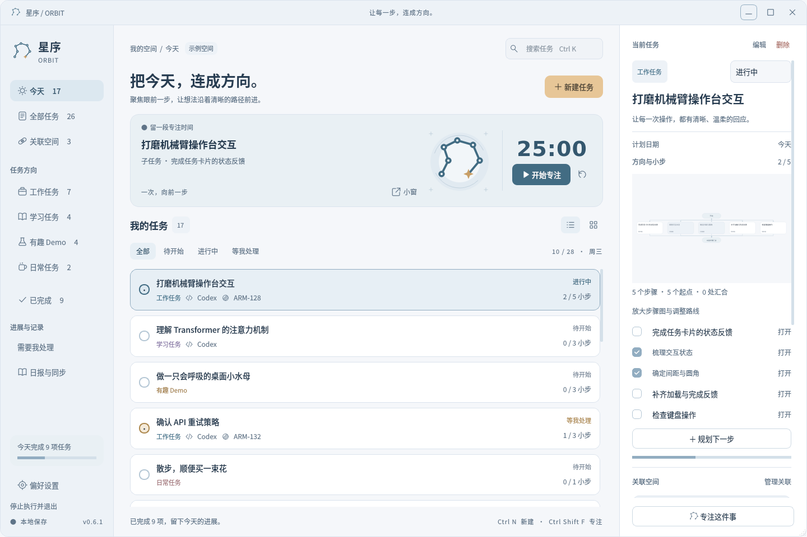
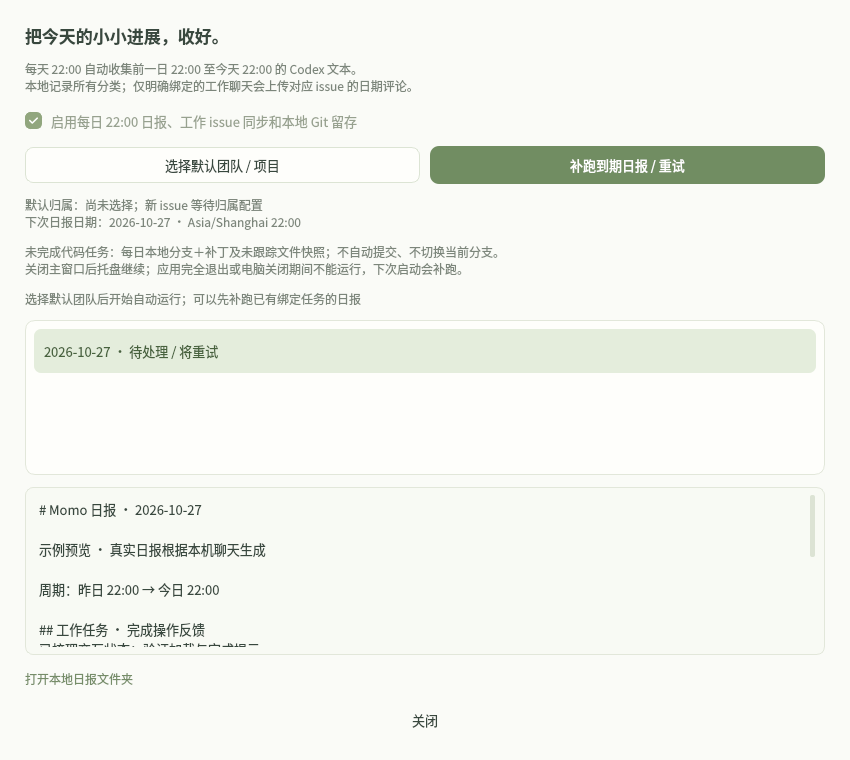

# 星序 / ORBIT 0.9.0

简约、亲切的 Linux 原生桌面注意力工具。七节点轨迹标记、雾白与蓝灰配色，用轻量的精密感连接工作、学习、Demo 和日常事项。PyQt5 界面、真实 YomkServerPy 服务，同进程复用固定版本 Work Station。主题规范见 [品牌文档](docs/BRAND_THEME.md)，更多工程说明见 [docs/](docs/README.md)。



## 应用下载

[0.9.0 安装包、校验与说明](release/README.md)。提供 Linux x86_64 的 `.deb` 和便携压缩包，内置 Python/Qt；安装后从应用菜单启动，或解压后运行 `orbit/orbit`。升级前先从旧版托盘退出。

## 从源码运行

Python 3.11+（实测 3.12.14），安装 requirements.txt 后运行：

```bash
python3.12 -m venv .venv
.venv/bin/python -m pip install -r requirements.txt
./run.sh
```

启动器优先项目 .venv，其次已安装依赖的系统 Python 3.13 / 3.12 / 3.11；支持 MOMO_PYTHON 指定解释器。源码需要自行准备依赖；发布应用已包含运行环境。启动日志位于 `~/.local/state/orbit/startup.log`（支持 `XDG_STATE_HOME` / `MOMO_LOG_DIR`），超过 5 MiB 留存上一份日志，避免持续增长。

```bash
./run.sh --data-dir /absolute/path/to/momo-data
.venv/bin/python check_env.py
.venv/bin/python main.py --version
QT_QPA_PLATFORM=offscreen .venv/bin/python main.py --self-test
```

Linux 需要 Qt xcb 依赖，推荐 Noto CJK 字体。没有图形环境时可以设置 QT_QPA_PLATFORM=offscreen 截图或测试。

## 任务、聊天与工作站

- 四类事项、日期、四态、列表/看板、搜索、删除、续接笔记、专注计时和小窗。
- 任务详情「进度与依据」可记录计划、执行结果、验证记录和人工验收，可带入任务笔记并填写报告/文件/聊天来源。记录不会自动改任务状态；撤回保留原文和时间，结构移动与撤销保留记录。来源不自动读取或执行；记录是人工陈述，不代表系统已核验。
- 拖动卡片或点阵把手调整先后顺序，蓝灰插入线显示落点，靠近列表上下边缘自动滚动。列表与看板同列均支持，顺序立即保存，重启后保留；筛选时只重排可见任务，隐藏任务保持原位。看板跨列不调整状态，步骤的显式前置依赖保持不变。
- 拖到卡片中部后，弹窗选择「作为子步骤合入」或「接在此任务之后」，取消不改变关系；后者建立同层显式依赖，根级任务也支持。保留原任务、聊天、笔记与完整子树；已有依赖与新层级冲突时需先明确调整。工作任务父级本地立即生效，远端 issue 父级在下一次 22:00 同步，旧日报重试不会提前发布新关系。
- 子任务也能直接拖到另一张任务卡片中部，确认后更换父任务。要恢复独立，先展开子步骤，拖到列表上方固定的「拖到这里，移为独立任务」区域后确认；列表和看板均支持，不改变状态，保留原任务 ID、已有子树、课程与聊天绑定。原父任务的步骤摘要同步移除该项；工作任务保留可确定的原归属，Linear issue 父级在 22:00 清空。若已有前置或后续依赖，先提示调整依赖，不擅自删除。
- 详情「任务位置」显示完整所属路径，可打开父任务，也可通过「移动到其他任务」搜索同分类的全部目标（跨日期和筛选，包含已收起的步骤），明确选择合入或连接为后续步骤。列表排除自身和后代，按钮按当前依赖检查可用性；移动成功自动定位，必要时清除筛选。子任务另提供「移为独立任务」，与拖出采用同一确认和保存流程。
- 详情「步骤依赖」同时展示直接前置与直接后续任务，支持打开定位；尚无依赖时也可进入管理并添加。移动弹窗和拖出冲突提示均提供「管理相关依赖」，可选择当前任务或依赖它的后续任务，明确勾选其前置步骤。保存后重新检查移动条件，不自动移出、不删除未取消勾选的依赖；仍由服务拒绝循环与跨层依赖。
- 子步骤默认收在父任务内，父卡片显示「展开 N 个子步骤」及完成数量。展开后以缩进、层级线、淡色卡片和「子步骤 · 父任务名」区分；列表与看板共用展开状态，看板中的步骤仍按各自状态分列。「后续步骤」保持同层独立卡片，并标明前置任务。搜索、状态筛选、关联空间和已完成视图会自动展开匹配步骤的路径；不符合筛选的父任务以虚线路径卡呈现，也可手动收起。从详情或步骤图打开子步骤会展开并定位。间隙拖动只调整同层顺序；跨层合入仍需拖到卡片中央后确认。展开状态仅保留在本次运行中，不修改任务数据。
- 「规划下一步」每行录入方向或小步，可加入并行方向或接在选中步骤之后；勾选多个前置步骤表达汇合。每个小步仍是独立任务，拥有自己的状态、聊天和工作 issue。
- 详情自动显示从上到下的原生步骤 DAG，放大后边编辑边预览，支持拖动、缩放和适应画布。旧任务不会被自动推断先后顺序；依赖只用于规划，后台不自动按图执行。见 [文档](docs/TASK_PLANNING.md)。
- 父级完成不自动完成子级；删除父级前需处理子任务，删除前置任务前需明确解除依赖。
- 工作任务与 Linear issue 一一对应。允许本地待同步草稿；晚间为每个父/子任务各建 issue，子 issue 继承父级团队、项目和负责人。
- My Issues 只在工作分类拉取、勾选导入并去重，保留本地笔记与进度。其他分类禁止新增 issue，也不会上传到 Linear。
- 工作事项可关联本地仓库、worktree 或远程地址；不自动 clone。每日代码留存需要显式关联本地仓库。
- Codex 提供并列的「新建聊天」「绑定已有聊天」按钮。选择已绑定真实聊天的任务时，详情中的 Codex 标题变为可点击的「打开任务 Codex」，直接打开对应聊天；多个关联时先选择。新建时选择工作目录，创建空聊天并绑定；绑定已有聊天时可搜索历史、查看内容或粘贴链接，用户选中才绑定。
- 按当前需求移除项目空间、本机执行两页以及项目关联、提交和重试入口；保留「需要我处理」，用于查看已有待处理记录、验收交付、打开日志和产物。后台 Yomk 服务继续支持日报和 Git 互斥留存。

执行使用 PATH 中的系统 Codex，继承现有 CODEX_HOME、配置、provider 和认证，不额外登录、不覆盖模型。相同 Git 根或重叠目录互斥。补充/重试创建新的一次执行并保留旧结果；异常重启不自动重投，不冒充 DAG/checkpoint 恢复。

## 学习任务与课程

阅读器会按任务与课程保存最后阅读章节、滚动位置和未发送问题，下次「开始学习」继续阅读。章节版本变化时从章首开始；不会自动发送问题、勾选完成或改变任务进度。记录独立保存在 `learning/reading.json`，保存失败会保留输入并阻止关闭阅读器。

学习卡片和详情明确显示教程绑定状态：无课程时突出「创建课程」；生成中可查看进度。已有知行课程由用户从列表选择，或绑定此任务实际生成的课程，不根据名称猜测关系。

有已绑定课程时显示「开始学习」，点击后直接进入原生阅读器。右侧上方为固定的「核心知识」区域：正文滚动不影响它，切换章节时更新当前章的公式与关联知识结论。下拉选择知识点，优先显示课程明确标注的「公式回顾」等汇总块；保留原文、适用范围、条件和来源，可引用到答疑框后继续提问。内容由代码从现有课程中整理，不额外调用模型，也不提前展示练习或自测参考答案。上下区域可拖动分隔条调整高度，收起答疑仍保留知识区。

右侧下方「随课答疑」固定通过系统 Codex CLI 请求 `gpt-5.6-sol`，沿用当前 provider、CODEX_HOME 和登录；模型不可用会明确显示错误，不自动改用其他模型。问答自动附带提问时的章节、相关知识单元与先修知识、课程来源，并可引用正文选文。支持本课程内多轮追问、停止回答、收起答疑及切换章节；切章不改变已经发出的提问上下文。问答按任务与课程隔离，保存在 `learning/tutor/state.json`，原始本次上下文与 CLI 日志位于 `learning/tutor/runs/`，使用临时 CLI 会话，不创建额外的任务聊天绑定。问答并发沿用学习模块的并发数；关闭阅读器或收起到托盘后继续，完整退出会停止并保留历史，不自动重投。课程正文、练习作答和任务完成状态不由问答修改。

点击「创建课程」只需学习对象，默认取任务名称，不询问掌握程度或个人学习目标。后台系统 Codex CLI 按教学 skill 先检索资料、建立较全面的知识库，再组织从先修基础到进阶应用的学习路径，编写完整正文与练习。知识库包含知识覆盖清单、来源、结论、先修关系与具体缺口；程序检查所有知识单元都有课程承接、阶段覆盖每章且无循环依赖，并在阶段内自动排序。可设置生成并发数、查看进度或停止；只有学习对象本身存在无法确定的歧义时才澄清对象。

阅读器新增「学习路径」，按阶段进入章节；「知识库与来源」展示已覆盖领域与待补内容。代码将校验后的知识库和路径分别保存为 `knowledge-base.json`、`learning-path.json`。外部资料不可用时保留缺口，结构检查不能证明学科已穷尽或替代教学质量核查。历史课程、章节绑定和作答继续兼容。

固定原生 Qt 阅读器支持正文、公式、代码示例、表格、折叠自测和练习；不执行生成的 Python、JS 或 HTML。作答按任务、课程和题目版本保存；书面题仅对照参考过程，阅读和查看答案不会自动完成任务。知行本地 14 节课、48 题已保留正文和稳定 ID；旧浏览器作答与原交互图解未自动迁移，缺口在课程中标明。

生成期间修改任务上下文或重新选择绑定时，结果保留为草稿供明确选择，不覆盖新选择。收起到托盘后继续生成，完整退出时停止后台 CLI；重启保留记录，不自动重投。实现与验证边界见 [文档](docs/LEARNING_COURSES.md)。

## 每晚 22:00 日报与自动进度

「日报与同步」增加「待同步工作任务」页，预览待创建 issue 和待调整父级的任务、同步时间、归属缺口与暂停状态，可直接定位任务。此页只读取本地记录；日报评论、失败原因和 Git 留存结果继续在日报记录页查看。

1. 在「拉取 My Issues」配置 Linear 密钥，可选择在本机记住。
2. 打开侧栏「日报与同步」，选择默认团队和可选项目，负责人为当前 Linear 用户。完成选择后开始自动排程；未同步根任务可单独覆盖归属。
3. 为工作任务明确绑定自己的 Codex 聊天；子任务可绑定另一段聊天。不确定归属时应用不会猜测。
4. 每晚 Asia/Shanghai 22:00 收集前一日 22:00 至当天 22:00 的本机用户/助手文本；22:00 后的聊天进入次日日报。
5. 本地保留所有分类及未绑定聊天；只有明确绑定的工作聊天摘要按日期追加到对应 issue 评论，不覆盖描述，不自动改 Linear 状态。

枚举、时间过滤、去重、关联、统计和重试由代码完成；只有必要文本压缩调用本机 Codex。压缩采用临时会话、内容缓存和分块处理，不把生成日报的会话再次收进次日日报。当前采集本机保存的 Codex JSONL，不声称包含尚未同步到本机的云端记录。

日报窗口展示处理阶段、日期、错误和本地报告，并提供「补跑到期日报 / 重试」。离线或完全退出后下次运行补齐到期日期；失败项每 5 分钟重试。创建 issue/评论前持久化 UUID，超时后先核对相同 ID。一个聊天同时绑定多个任务时暂不上传，需明确唯一归属。

人工进度记录由代码按相同 22:00 周期归入本地日报，包含本周期新增及对旧记录的撤回，重试复用第一次保存的输入。无需模型压缩；导出的文字使用现有密钥脱敏规则。它们不加入 Linear 评论，远端仍只发布明确绑定的工作聊天摘要。旧日报不追补新功能上线前未收集的记录；任务中的记录长期保留，不属于 30 天清理候选。



## Git 每日留存

未完成工作任务显式关联本地仓库后，每晚创建 momo/daily/日期/issue-任务短ID 本地分支，并保存：

- staged.patch：暂存区相对基准提交的二进制补丁。
- working.patch：工作文件相对暂存区的二进制补丁。
- untracked.tar：未跟踪且未被忽略的文件，符号链接不跟随。
- manifest.json：任务、issue、基准、分支、实际捕获时间和文件摘要。

不自动提交、不切换当前分支、不改变暂存区、不推送、不自动加 tag。任务完成后由用户手动整理和提交，是否为正式提交加 tag 由用户决定。分支/tag 本身不能保存未提交修改，因此需要同时保留快照目录。

补跑捕获当前代码，不能回溯关机期间的历史文件状态。正在执行的同仓库任务会阻止留存，等待空闲重试。无初始提交、裸仓库、脏子模块、代码在捕获期间变化或分支冲突会显示具体原因。恢复步骤见 [文档](docs/DAILY_PROGRESS_PLAN.md)，应在独立副本进行。

## 数据与退出

默认数据目录为 Qt AppDataLocation，Linux 通常是 ~/.local/share/MomoLocal/Momo；可用 --data-dir 指定。应用显示名称已更新为「星序 / ORBIT」，内部应用标识与数据目录保持兼容。

```text
momo.lock                     在任务加载/迁移前取得的空间锁
tasks.json                    v2 任务、父子关系、偏好、专注
tasks.json.v1-backup           首次 v1 迁移前的原文件
.credentials/                 本机凭据回退目录，不进入任务或发布包
station/                      工作站 SQLite、备份、日志、工作区、执行记录
daily/daily.sqlite3           消息索引、报告输入、摘要缓存、同步操作账本
daily/YYYY-MM-DD.md           日期日报，可读投影
daily/git/                    每日补丁与未跟踪文件快照
daily/compression/            文本压缩输出和诊断
learning/state.json           明确课程绑定、生成记录、作答与并发设置
learning/courses/             通过结构检查的版本化课程草稿
learning/generations/         原始输出、事件日志、错误和输入快照
```

原有下一步和勾选步骤迁移为真实子任务；原文件备份，不静默丢弃旧的多 issue 冲突。任务是本地状态，远端 issue 状态另显示。删除本地任务不删除远端 issue、仓库或执行记录。

关主窗口缩到系统托盘继续；显式「停止执行并退出」取消日报压缩和执行子进程，等待线程回收再关闭服务。托盘不可用且有后台处理时保留最小化窗口。电脑关闭/应用完全退出期间无法运行定时任务。

Linear 优先系统密钥环，回退到独立目录 0700 / 文件 0600 的凭据存储；也支持 LINEAR_API_KEY。发布包不含密钥、数据库和聊天原文。模型进程排除 Linear 凭据环境，保留当前 Codex 所需认证。不改动原工作站业务目录或系统 Codex 登录。

## 架构与验证

- DAILY_PROGRESS_PLAN.md：确认规则、R01–R15 任务拆分、数据与恢复。
- OPTIMIZATION_REVIEW.md：整体框架评估、已实施优化与后续建议。
- WORKSTATION_INTEGRATION.md：双方 Yomk 架构和固定工作站依赖。
- ARCHITECTURE.md、IMPLEMENTATION_TASKS.md、VERIFICATION.md：接口、实施及验证证据。

Momo 加载随包真实 YomkServerPy 1.5.6 源码，固定 Work Station 0.41.1 / 58ae2dfe3b951ac08382ace8e89dbbdd13f08c1d 使用其实际实例级 1.4.20 框架，两套类不混用。没有完整装配上游 Secretary/PM 自动执行 DAG、远端 worker 或 checkpoint 恢复；当前步骤 DAG 是本地规划图。

```bash
QT_QPA_PLATFORM=offscreen .venv/bin/python -m unittest discover -s tests -v
QT_QPA_PLATFORM=offscreen ./run.sh --data-dir /tmp/momo-preview --screenshot /tmp/momo.png
```

真实框架、SQLite、临时 Git 仓库和可控压缩进程已验证；真实模型摘要与 Linear 远端写入未作为测试运行，需使用自己的配置实际验收。

## 结构调整与大列表

合入与移出前展示位置变化、完整子树数量、后续依赖和 Linear 父级同步影响。「撤销结构调整」恢复最近一次合入、移出、排序或前置依赖调整，只恢复结构与顺序，保留之后的笔记、状态、聊天和课程。记录随任务原子保存，重启后仍可撤销；任务集合、归属或其他结构再次变化时拒绝覆盖，撤销工作任务父级会排入下一次 22:00 同步。新建和删除任务目前不支持撤销。

列表与看板按 80 项分批显示，底部可继续加载；搜索覆盖全部任务，定位自动加载目标所在范围。深层任务树采用迭代遍历；DAG 内容未变化时复用节点，保留当前选择和缩放。未引入自动执行依赖。

开发进展与验证记录见 [DEVELOPMENT_LOOP.md](docs/DEVELOPMENT_LOOP.md)。

「日报与同步 → 查看本地存储用量」后台扫描本数据目录的文件元数据，显示分类大小、文件数，以及原始输出/Git 留存中距最后修改至少 30/90 天的大小。扫描不读取内容、不跟随符号链接，支持取消；年龄列只是留存影响评估，尚非可安全删除清单。保留规则为30天，可点击「预览30天前留存」，核对清单并逐次确认后移入系统回收站；不自动执行，也不清空回收站。只纳入已完成日报、对应 Git 快照、已缓存的压缩输出及已结束的课程/答疑原始输出；目录内任一近期修改或链接会使整组保留。任务、课程正文、作答、聊天绑定和同步账本永久保留。日报文件清理后仍可从数据库阅读正文；Git 分支和实际仓库不受清理影响。

Codex CLI 0.159.3 新建空聊天使用显式 legacy 历史格式，并在绑定前检查实际会话文件已落盘，避免默认分页格式返回不存在的 rollout 路径。沿用当前系统配置与登录，不发送首条消息。修复前生成的失效空链接保留，可重新新建聊天并在管理关联中移除旧链接。
