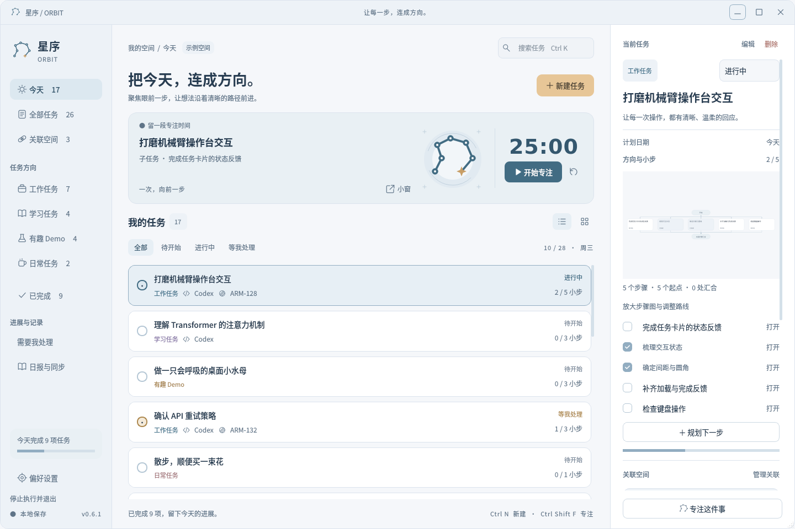

# 星序 / ORBIT

原生桌面任务工具，连接工作、学习与日常事项。支持任务拆解、Codex 聊天绑定、Linear 同步、课程学习和日报。



## 下载

[下载最新版本](https://github.com/SevenovaHangzhou/Personal_workstation_qyx/releases/latest)

- Linux x86_64：`.deb` 或便携包。
- Windows 10 / 11 x64：`setup.exe` 安装包或 `.zip` 便携包。

均内置 Python 运行环境；Windows 双击 `orbit.exe` 启动。

## 源码启动

需要 Python 3.11+；聊天和课程生成功能使用本机 Codex CLI。

```bash
python3 -m venv .venv
.venv/bin/python -m pip install -r requirements.txt
./run.sh
```

Windows 源码启动：`.venv\Scripts\python -m pip install -r requirements.txt`，再运行 `./run.ps1`。

关闭窗口会缩到托盘；完整退出请使用托盘菜单。更新将在完整退出后切换，下次启动生效。

## 文档

[运行图谱（可选）](docs/YOMKGRAPH.md) · [使用说明](docs/USAGE.md) · [安装与构建](release/README.md) · [自动更新](OTA.md) · [工程文档](docs/README.md)
