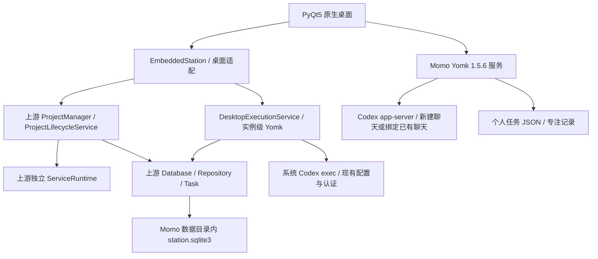

# Momo × Work Station 融合方案与实施状态

2026-10-27，Momo 保留为正式主工程，最新版工作站作为固定版本依赖引入。双方都采用 **YomkServerPy 架构**。本轮已实现 0.6.0 的原生桌面融合闭环；完整任务单见 `IMPLEMENTATION_TASKS.md`，验证边界见 `VERIFICATION.md`。

## 已确认的产品与架构决定

| 决定 | 实施规则 |
| --- | --- |
| Linux 原生桌面应用 | PyQt5；星序 / ORBIT 七节点轨迹主题，雾白、蓝灰、青蓝与少量琥珀色 |
| 同一个应用进程 | Momo 和工作站的领域服务在同一 Python 进程，不启动 HTTP 服务 |
| Python 3.11+ | 本轮实测 Python 3.12.14，使用真实 Yomk Python 源码运行库 |
| Momo 主工程 + 固定依赖 | `vendor/work_station` 固定导出，桌面适配位于主工程，原工作站目录未改动 |
| 只有工作任务需要 issue | 可创建本地工作草稿；22:00 为每个父/子任务建立唯一真实 issue；其他分类禁止新增 issue |
| 所有模型调用使用本机 Codex CLI | 沿用系统 Codex 的配置、模型/provider 与现有认证，不要求额外登录；不装配原工作站的模型 API、Claude 或 aider 调用路径 |
| 当前只面向单机执行 | 仅创建本地 Codex 子进程，无发现、远程 worker、联邦派发或跨机重试 |
| 用户设置并发数 | 首次执行前明确设置 1–32；同一仓库或重叠目录互斥 |
| 关闭主窗口缩到托盘 | 同进程继续运行；显式“停止执行并退出”才停止子进程并关闭服务 |
| 默认使用当前系统 Codex | 使用 PATH 中的 CLI，继承系统环境与 CODEX_HOME，不覆盖登录目录，不执行登录命令 |

## 固定源码与框架边界

最新版来源：`/home/kkozia/桌面/ing_obj/work-station/`，版本 0.41.1，commit `58ae2dfe3b951ac08382ace8e89dbbdd13f08c1d`。旧目录 `Personal-distributed-workstation` 不再作为接入依据。导出文件及 SHA-256 在 `vendor/work_station/PINNED_SOURCE.json`；没有随包导出私人配置、数据库或密钥。

Momo 使用 YomkServerPy 1.5.6；工作站包含真实上游 1.4.20 Python 源码及其有说明的导入、日志适配。它们的服务类和 Enum 不混用。Momo 的全局门面与工作站的实例级 ServiceRuntime 分别拥有资源，跨边界只传普通 Python 数据，不把同名 `/TaskService` 注册到同一服务表。

直接复用工作站的项目生命周期服务、任务模型、schema v12、任务与项目 repository、实例级 Yomk 注册、请求和关闭机制。桌面队列是独立适配服务，**本版没有装配上游完整 Secretary/PM/DAG 调度器**。规划、执行、检查由一次本地 Codex 任务完成；不把一条 CLI 执行伪装成已迁移的完整 PM 流程。上游完整调度依赖分布式控制器和模型路由，后续接入须单独核对并保持单机、Codex-only 约束。

## 分类与数据规则

| 分类 | Issue | 聊天 | 本机执行 |
| --- | --- | --- | --- |
| 工作任务 | 唯一 issue；允许待同步草稿，可拉取 My Issues | 新建聊天，或选择已有聊天绑定 | 可在本地执行；本地仓库可配置每日留存 |
| 学习任务 | 无入口，服务拒绝新增 | 可选关联 | 选择普通本地目录即可 |
| 有趣 Demo | 无入口，服务拒绝新增 | 可选关联 | 选择普通本地目录即可 |
| 日常任务 | 无入口，服务拒绝新增 | 可选关联 | 按需选择目录，仍以清单和专注为主 |

“真实关联”指已通过 URL 格式校验的非示例 Linear 链接，或导入时校验的 Linear issue 元数据；手动链接不声称已联网核实。历史缺 issue 的工作任务保留并提示待同步，允许本地执行。改为非工作分类时明确确认解除本地 issue；仓库需先从关联管理中移除。导入、分类和服务层均有校验。

个人任务、日期、笔记、步骤、专注仍以 Momo JSON 为准。项目、项目关联、提交、执行结果与验收以工作站 SQLite 为准。删除个人任务会保留执行历史并明确说明执行不会因此停止；不会删除远端 issue 或仓库。

## 原生界面与流程

侧栏新增“需要我处理、项目空间、本机执行”。工作站窗口提供项目、队列与待处理页签，显示实际状态、用户设置的并发上限和 系统 Codex 可用状态。任务详情可关联本机项目、提交执行、查看记录。已有的任务删除、My Issues、Git 关联、历史聊天推荐继续保留。

1. 创建本机项目，应用并发数；应用自动使用当前系统 Codex。
2. 创建个人任务；工作事项可先创建本地草稿，或导入、手动绑定真实 issue。
3. 点击“交给本机执行”，明确选择项目、工作目录、目标、验收条件及只读或目录写入权限。
4. 确认目录、Git 基准和已有更改后提交。一次提交拥有稳定 UUID；同 ID 同内容返回原记录，同 ID 不同内容拒绝。
5. 队列按并发上限运行；相同 Git 根目录、相同或相互包含的工作目录互斥。不会自动清理、提交或覆盖已有更改。
6. Codex 返回待补充或待验收；失败、退回和状态待核实也进入待处理队列。补充/重试明确创建新的一次执行，保留原结果；已续接记录不重复列入待处理。
7. 验收校验当前交付时间戳与状态；通过仅记录验收结论，不自动完成个人任务或写回 Linear。产物只打开实际存在且在确认工作目录内的文件。

历史推荐不会自动发送消息；工作执行在用户确认提交后调用模型；已配置的自动日报仅调用文本压缩。任务说明不会自动附带整段聊天或凭据；Codex 子进程保留现有认证环境并排除 Linear 环境变量。实际收到 Codex thread ID 时保存到执行结果，可在现有聊天关联入口明确绑定。

## 生命周期与恢复

工作站数据库、备份、日志、项目工作区、逐次执行日志均位于 Momo 数据目录的 `station/`。不读取原工作站业务数据库，不写入 `~/.lan_mesh`。应用锁在任何任务迁移前取得，工作站另有独立目录锁。

关窗只隐藏到可用系统托盘，运行时与专注时钟继续存在；托盘不可用且有执行时保留最小化窗口，并明确提示。显式退出先停止排队生产者，对运行中的整个 Codex 进程组发送停止信号、等待退出，再关闭拥有的 Yomk 实例与 SQLite 连接。

进程异常退出后，原“执行中/排队中”统一转为状态待核实，不自动重投。用户检查目录后填写说明，才创建新的一次执行。这里的“补充/重试”是重新提交，**不是恢复旧 Codex 会话或上游 DAG checkpoint**。

## 验收与后续边界

本轮完成：分类不变量、固定依赖、Python 3.11+ 装配、原生项目与队列、同机 Codex 执行运输、并发与目录互斥、停止、补充、重试、验收、托盘与重启核实。验证使用真实两套 Yomk 与 SQLite、可控的真实子进程，不发送模型任务。

无需补充登录信息或目录；真实模型执行由用户明确提交任务后启动。尚未宣称完成：上游完整 PM/DAG 可视化、暂停/checkpoint 恢复、自动 worktree 隔离、执行聊天自动绑定与 Linux 各桌面托盘实机兼容性。这些是后续独立工作项，不能用当前队列测试代替验收。

## 0.6.0 自动进度扩展

新增 DailyService、增量聊天索引、必要文本压缩、父子 issue 同步和 Git 每日分支/补丁/文件归档。双方框架和固定依赖未变。已确认规则和细分实施见 `DAILY_PROGRESS_PLAN.md`；框架评估和已实施优化见 `OPTIMIZATION_REVIEW.md`。
