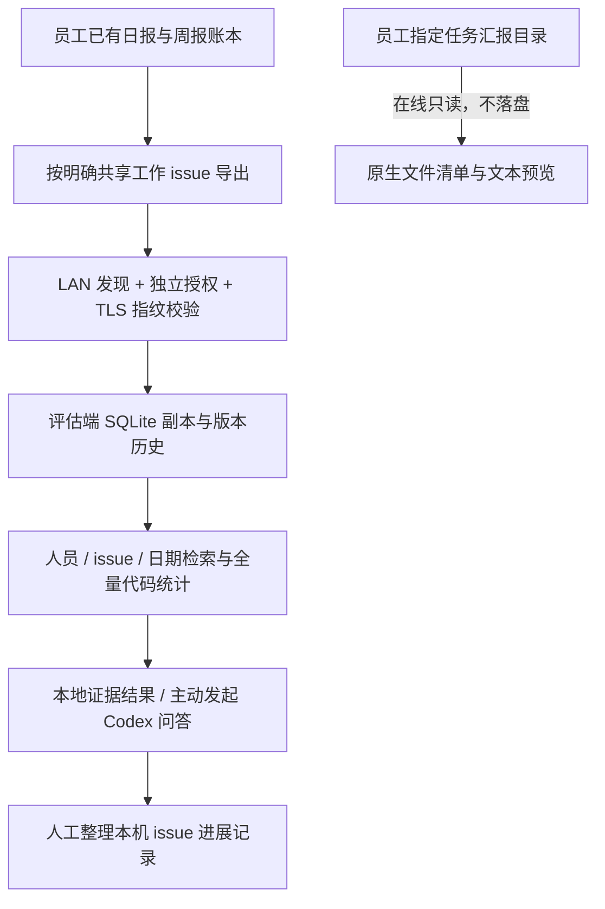

# 星序 · 员工日志评估

分支：`evaluator`。2026-11-11 已获开发授权，原生 Qt + YomkServerPy；与 `main`、`luma` 分开维护。

## 已确认边界

- 员工明确启用共享，只开放勾选的工作 issue 日志。Demo、日常、原始聊天、Git 留存和凭据不共享。
- 复用个人端已有自动日报及「下班／总结周报」账本，按任务导出摘要和人工进度证据，不要求重复填报。
- LAN Mesh 自动发现；发现不授予读取权。员工为每个评估端单独生成授权，评估端核对身份及 TLS 指纹后导入。
- 日志副本保存在评估端本机。员工离线后仍可查询，界面显示最后成功同步时间。
- 汇报文件夹由员工选择，为任务建立固定目录。附件只在线读取，不复制到评估端磁盘。
- 评估人员针对日志提问，代码统计数量，模型仅作证据总结；可据此保存本机 issue 进展、阻碍、下一步和修改历史。
- **本系统不做验收，也不做老板评分。** 此项是最新决定，取代此前验收完成值方案。
- 百分比按明确核对完整的子 issue 清单及 Linear 完成状态加权计算；日志只补充进展、阻碍和下一步。
- 新流程不写回 Linear；原个人端 22 点同步逻辑保持原有行为。

## 实现结构

`EvaluationService` 归属工作版 Runtime，管理共享、发现、同步、问答和关闭顺序。默认关闭联网；学习版不注册该服务。网络和模型在后台线程运行，不占用界面线程。

- `evaluation/protocol.py`：严格字段白名单、稳定 ID、周期、issue UUID 和 SHA256。
- `evaluation/journals.py`：账本导出、SQLite 副本、修订历史、原子完整同步。
- `evaluation/mesh.py`：局域网发现、TLS、独立且可撤销的只读授权、日志和在线资料协议。
- `evaluation/reports.py`：汇报资料安全路径、目录标识和文本读取。
- `evaluation/insights.py`：范围筛选、去重统计、检索、issue 关系与进度展示。
- `evaluation/qa.py`：系统当前 Codex 的临时只读问答，关闭命令、联网及 MCP 工具。
- `evaluation/ledger.py`：进展摘要、阻碍、下一步、证据版本和修改历史。
- `evaluation/roster.py`：员工、设备、Linear 账号与固定日志归属，带版本检查和修改历史。
- `evaluation/people.py`：仅针对当前授权副本汇总人员贡献与 issue 负责人，沿用检索时间范围。
- `evaluation_ui.py`、`evaluation_roster_ui.py`：我的共享、员工与同步、日志问答、进度台账、汇报资料、员工与设备。

192.168.100.30 不承担日志副本存储，本功能不要求服务器部署。

## 同步与权限

清单比对后只获取新增或变化的记录。完整清单、所有 payload 和哈希验证通过后，在同一 SQLite 事务中更新副本、可见范围和成功时间。失败保留上次成功数据，不能显示为同步成功。

每台来源设备拥有独立 UUID、独立授权，姓名不作为权限依据；协议中的旧 `employee_id` 仍代表来源身份，原始记录与哈希不被名册改写。评估端另外维护人员 UUID，可明确归档多台设备。既有来源不会自动创建或合并人员。每次同步最多 10000 条、32MiB，单条最多 200KiB；超限明确失败，不返回被截断的完整清单。

日志按设备和稳定记录 ID 首次认领后固定人员归属，设备交接不搬走已认领历史。账号按 Linear URL 工作空间 slug 与真实用户 UUID 唯一对应；只有明确 assignee 及已绑定账号才能确定负责人。贡献者不等同于负责人。员工详情逐项汇总，不合成误导性的员工总完成率；来源撤回后派生汇总与台账同步隐藏。

成功取得缩小后的完整清单会隐藏撤回记录，历史版本不物理删除。收到鉴权拒绝时隐藏该员工副本并清空相关问答；普通离线保留副本。员工直接关闭应用与撤权后离线无法远程区分，因此本版不承诺远程销毁离线副本。新的组织保留政策尚未指定，不自动将原产物 30 天规则扩展到组织副本。

## 问答与进展更新

本地检索不调用模型。先统计整个匹配集合，再提供有限证据片段；不能将片段声称为完整阅读。每条来源带员工、issue、周期、源 ID 和哈希，周期重叠不把同一证据重复累计。

Codex 问答由评估人员主动发送并确认所选证据的模型处理，沿用当前系统配置和登录；不自动选择其他模型。资料中的指令不执行，模型输出不能自动修改进度、任务或 Linear。可取消，结束后清理临时文件。CLI 调用参考 [Codex 非交互模式](https://developers.openai.com/codex/noninteractive/)。

保存 issue 进展须明确确认并引用该 issue 当前有效的日志版本。记录修改人、时间、来源和修订号；并发修改冲突要求刷新。资料撤回后，派生记录也不再出现在当前查询范围；来源已修订则标明旧版本需核对。

子 issue 权重按层归一化，最终叶项去重，取消项从分母排除。未拆分、子项清单不完整或状态缺失显示待估。状态取自员工端任务当前缓存，随共享日志同步，不实时读取 Linear，也不支持历史时点状态回放。界面分别显示「最早依据日志」周期和员工最后成功同步时间；两者都不代表 Linear 状态实际读取时间。

## 汇报资料

目录结构：`员工选择的根目录/<任务UUID>/.orbit-report.json`。目录名用于稳定绑定；可见标题在应用中展示。换绑 issue 后不把旧资料静默改绑。

最多 500 份文件，普通文件上限 100MiB。UTF-8 的 txt、md、csv、json 可在线预览，预览上限 2MiB；较大文件及图片、其他文档只列元数据，不宣称已理解内容。隐藏文件、凭据、证书、数据库、符号链接及目录越界不共享。无口头资料时不编造汇报，也不要求录音。

## 尚需用户决定或试点验证

- 是否增加 Linear 状态的实时只读刷新及准确的状态读取时间。
- 是否及怎样写回 Linear；目前只保存评估端记录和可复制草稿。
- 正式组织登录账号、老板可见范围、多个评估端名册协同及组织保留政策。
- Windows 的真实双机联调、公司网络的 UDP 发现与防火墙策略。

使用步骤见 [评估功能手册](EVALUATOR_GUIDE.md)。
